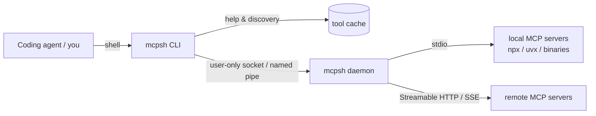

<div align="center">

# mcpsh

### Every MCP server, one shell command away.

**mcpsh** turns the tools of any [Model Context Protocol](https://modelcontextprotocol.io) server into
plain CLI commands, so Claude Code, Codex, GitHub Copilot (and you) can use them with nothing but a shell.

[](https://github.com/davidemaggi/mcpsh/actions/workflows/ci.yml)
[](go.mod)
[](LICENSE)


[Quickstart](#-quickstart-5-minutes) ·
[Why](#-why-mcpsh) ·
[Commands](#-commands) ·
[Configuration](#%EF%B8%8F-configuration) ·
[Security](#-security-by-default) ·
[Roadmap](#%EF%B8%8F-roadmap)

</div>

```console
$ mcpsh add github --env GITHUB_PERSONAL_ACCESS_TOKEN='${GITHUB_TOKEN}' -- npx -y @modelcontextprotocol/server-github
$ mcpsh github
Tools of "github" (41):
  create_issue     Create a new issue in a GitHub repository
  list_issues      List issues in a GitHub repository with filtering options
  ...
$ mcpsh github create_issue --owner acme --repo api --title "Login is broken" --labels bug --labels p1
Created issue #482: https://github.com/acme/api/issues/482
```

---

## ✨ Why mcpsh?

MCP is great. Wiring every server into every agent is not: each tool has its own config format,
servers load their whole tool catalogue into the context window, and slow `npx` servers start
again and again.

mcpsh takes a different route: **one binary, configured once, used through the shell that every
coding agent already has.**

- 🪶 **Zero runtime.** A single, statically compiled executable for Linux, macOS and Windows.
  No Node, no Python, no Docker for mcpsh itself.
- 🧠 **Context-friendly by design.** Agents discover tools progressively
  (`mcpsh list` → `mcpsh <server>` → `mcpsh <server> <tool> --help`) instead of loading every
  schema up front.
- 🧩 **Real CLI flags from JSON Schema.** Strings, numbers, booleans, enums, repeatable arrays,
  defaults and required parameters become `--flags`, validated *before* the call. Complex input?
  `--json '{...}'`, `--json @args.json` or `--json -`.
- 📋 **Bring your config.** Uses the same `mcpServers` format as Claude Desktop and `.mcp.json`;
  `mcpsh import` copies an existing file.
- 🔒 **Secure by default.** Secrets stay in environment variables, project servers need your
  approval, destructive tools need `--yes`.
- 🤖 **Made for agents, pleasant for humans.** Clean stdout, errors on stderr, `--output json`
  for machines, and [documented exit codes](#-exit-codes).
- ⚡ **Warm sessions.** A per-user background daemon keeps servers running between calls, so a
  slow `npx` server starts once, not on every command. It starts by itself, stops idle servers,
  restarts crashed ones and gets out of the way with `--no-daemon`.
- 🧹 **No orphans.** Every server runs in its own process tree (a job object on Windows, a process
  group on Unix) and is cleaned up completely, even behind `npx.cmd` shims.

## 🚀 Quickstart (5 minutes)

> mcpsh needs no runtime. The MCP **servers** you add may: servers started with `npx` need
> Node.js, servers started with `uvx` need Python with [uv](https://docs.astral.sh/uv/).

**1. Install**

| Platform | Command |
| --- | --- |
| macOS (Homebrew) | `brew install --cask davidemaggi/tap/mcpsh` |
| Windows (winget) | `winget install DavideMaggi.mcpsh` |
| Windows (Scoop) | `scoop bucket add davidemaggi https://github.com/davidemaggi/scoop-bucket` then `scoop install mcpsh` |
| Linux, macOS | `curl -fsSL https://raw.githubusercontent.com/davidemaggi/mcpsh/main/install.sh \| sh` |
| Windows (PowerShell) | `irm https://raw.githubusercontent.com/davidemaggi/mcpsh/main/install.ps1 \| iex` |
| Anywhere with Node.js | `npm install -g @davidemaggi/mcpsh` |
| From source (Go) | `go install github.com/davidemaggi/mcpsh/cmd/mcpsh@latest` |

Or grab an archive from [Releases](https://github.com/davidemaggi/mcpsh/releases): every file is
listed in `checksums.txt` and has a [build attestation](https://docs.github.com/actions/security-for-github-actions/using-artifact-attestations)
(`gh attestation verify <file> --repo davidemaggi/mcpsh`). On Windows, prefer the `-signed` zips:
`mcpsh.exe` is Authenticode-signed. The install scripts, Scoop and npm pick them automatically.

> **macOS:** mcpsh is not notarized yet. Homebrew and `install.sh` take care of it; if you
> download the archive yourself, run `xattr -d com.apple.quarantine ./mcpsh` once.

**2. Add a server**

```sh
# a local (stdio) server
mcpsh add fs -- npx -y @modelcontextprotocol/server-filesystem .

# a remote server, token from the environment
mcpsh add github --url https://api.githubcopilot.com/mcp/ --header 'Authorization: Bearer ${GITHUB_TOKEN}'

# or reuse what you already have
mcpsh import .mcp.json
```

**3. Explore and call it**

```sh
mcpsh list                                   # servers and their status
mcpsh fs                                     # tools, one line each
mcpsh fs read_text_file --help               # parameters, generated from the schema
mcpsh fs read_text_file --path README.md     # call it
mcpsh fs list_directory --path . -o json     # full MCP result as JSON
```

**4. Teach your agent**

```sh
mcpsh skill install                         # Claude Code, Codex and Copilot, for your user
mcpsh skill install --scope project         # or commit them with the repository
```

…or with the [skills CLI](https://github.com/vercel-labs/skills), without installing mcpsh first
(the skill offers to install it when it is missing):

```sh
npx skills add davidemaggi/mcpsh
```

You get two [Agent Skills](https://agentskills.io):

- **`mcpsh`** teaches the agent to discover progressively (`mcpsh list` → `mcpsh <server>` →
  `mcpsh <server> <tool> --help`) and call tools, with `--output json` when it needs to process
  the result. No tool catalogue is loaded into the context up front.
- **`mcpsh-setup`** configures new servers for you: hand your agent an npm or PyPI package, a
  Docker image, a URL, a README or a `.mcp.json` snippet and say *"set this up with mcpsh"*. It
  picks the transport, keeps secrets in `${VAR}` references, chooses the scope, verifies the
  connection and suggests tool filters.

Prefer plain instructions? `mcpsh agents-md >> AGENTS.md` (or `CLAUDE.md`,
`.github/copilot-instructions.md`). Want the agent to know *when* to reach for a specific server?
`mcpsh skill generate <server>`.

## 🧰 Commands

| Command | What it does |
| --- | --- |
| `mcpsh list [--check]` | Configured servers, transport, cached tool count, status. `--check` contacts each server. |
| `mcpsh <server>` | The server's tools, one line each (`-o json` for a machine-readable list). |
| `mcpsh <server> <tool> --help` | Full description, annotations and the flags generated from the input schema. |
| `mcpsh <server> <tool> --schema` | The raw input and output JSON Schema. |
| `mcpsh <server> <tool> [--param v ...]` | Call the tool. `mcpsh call <server> <tool>` is the explicit form. |
| `mcpsh resources <server> [uri]` | The server's resources and URI templates, or read one (binary content is saved to a file). |
| `mcpsh prompts <server> [prompt] [--arg name=value ...]` | The server's prompts and their arguments, or get one rendered. |
| `mcpsh auth login\|logout <server>`, `mcpsh auth status` | Log in to OAuth servers in the browser; tokens are stored and refreshed for you. |
| `mcpsh add <name> -- <cmd> [args]` | Add a stdio server (`--env K=V`, `--cwd`, `--scope user\|project`). |
| `mcpsh add <name> --url <url>` | Add a remote server: Streamable HTTP, or legacy SSE with `--transport sse` (`--header "Name: value"`). |
| `mcpsh remove <name>` | Remove a server. |
| `mcpsh import [file]` | Copy servers from a `.mcp.json`-style file. |
| `mcpsh trust [server] [--all]` | Review and approve servers defined by the project file. |
| `mcpsh refresh [server]` | Fetch tool lists again and update the cache. |
| `mcpsh daemon start\|stop\|restart` | Control the background daemon (it also starts by itself). |
| `mcpsh daemon status` | Running servers with PID, uptime, calls, restarts and last error. |
| `mcpsh daemon logs [-n 100] [-f]` | The daemon log (never contains secrets). |
| `mcpsh skill install [--target claude\|codex\|copilot\|all] [--scope user\|project]` | Install the `mcpsh` and `mcpsh-setup` Agent Skills. |
| `mcpsh skill generate <server> [--description "..."]` | Write a skill for one server, so agents know when to use it. |
| `mcpsh agents-md` | Print a snippet for `AGENTS.md` / `CLAUDE.md` / `copilot-instructions.md`. |
| `mcpsh version` | Version and build information. |
| `mcpsh self-update [--check] [--version X]` | Update to the latest release (checksum-verified; the signed build on Windows). Package-manager installs are told which command to use instead. |

Global flags: `-o, --output text|json`, `--timeout 30s`, `-y, --yes`, `--no-daemon`.
Tool names also work in kebab-case (`create-issue`), and so do parameter flags (`--page-size`).
A parameter whose name clashes with a global flag is exposed as `--param-<name>`.

### Output

- Text content goes to **stdout**; when the tool reports an error it goes to **stderr**.
- Images, audio and binary resources are saved to a temporary file and the path is printed.
- Results with only `structuredContent` are printed as indented JSON.
- `--output json` prints the complete MCP result: `content`, `structuredContent`, `isError`.

### 🚦 Exit codes

| Code | Meaning |
| --- | --- |
| `0` | Success |
| `1` | The tool reported an error (`isError`) or the server rejected the call |
| `2` | Usage, validation, configuration or trust error: fix the command or the config |
| `3` | Connection, transport, timeout or daemon error: the server could not be reached or crashed |

## ⚙️ Configuration

Two files, merged; the project wins:

| Level | Location |
| --- | --- |
| User | `~/.config/mcpsh/config.json` (Linux/macOS, honours `XDG_CONFIG_HOME`) · `%APPDATA%\mcpsh\config.json` (Windows) |
| Project | `.mcpsh.json`, searched from the current directory up to the repository root |

```jsonc
{
  "mcpServers": {
    "github": {
      "type": "http",
      "url": "https://api.githubcopilot.com/mcp/",
      "headers": { "Authorization": "Bearer ${GITHUB_TOKEN}" },
      "allowTools": ["*issue*", "get_*"],      // optional: only expose these (globs)
      "denyTools": ["delete_*"],               // optional: hide these
      "timeout": "60s"
    },
    "fs": {
      "command": "npx",
      "args": ["-y", "@modelcontextprotocol/server-filesystem", "."],
      "env": { "LOG_LEVEL": "${FS_LOG_LEVEL:-info}" },
      "confirmTools": ["write_*"],             // ask for --yes even without a destructive hint
      "startupTimeout": "2m",
      "roots": true                            // advertise the project root (default)
    },
    "legacy": { "disabled": true }             // in a project file: hide a user server
  },
  "settings": { "callTimeout": "60s", "cacheTTL": "24h", "idleTimeout": "10m", "daemonIdleTimeout": "30m" }
}
```

- Remote servers use `"type": "http"` (Streamable HTTP, the default with a `url`) or `"sse"`
  (legacy SSE); `headers` are sent with every request.
- `${VAR}` and `${VAR:-default}` are expanded from the environment in `command`, `args`, `env`,
  `cwd`, `url` and `headers`. A missing variable is a clear error, never an empty secret.
- A project server with the same name replaces the user server entirely.
- stdio servers start in the project root (the folder with `.mcpsh.json`, else the git root).
- Tool lists are cached on disk (`cacheTTL`, default 24h), so `--help` is instant and never
  starts a server. `mcpsh refresh` updates them.

### 🔑 OAuth

Remote servers that use OAuth need no configuration: log in once, mcpsh does the rest.

```sh
mcpsh add tracker --url https://mcp.example.com/mcp
mcpsh auth login tracker    # opens the browser, stores the token
mcpsh tracker               # works from now on, in every shell and for every agent
mcpsh auth status           # who is logged in
mcpsh auth logout tracker
```

- The authorization code flow with PKCE, dynamic client registration and refresh tokens, as the
  MCP specification describes it. Tokens are refreshed automatically.
- Calls **never** open a browser: if a server needs a login, the call fails with exit code `2`
  and tells you to run `mcpsh auth login <server>`, so an agent cannot get stuck on a login page.
- Tokens live in the user's state directory, encrypted with DPAPI on Windows and readable only
  by you elsewhere; never in config files or logs.
- A pre-registered client? `"oauth": {"clientId": "...", "clientSecret": "${SECRET}", "scopes":
  ["read"], "redirectPort": 8765}`. A server that takes a static token? Set the `Authorization`
  header instead, and OAuth stays off (or `"oauth": {"disabled": true}`).

## 🔒 Security by default

- **No secrets in project files.** `mcpsh add --scope project` refuses clear-text values for
  secret-looking env vars and headers (`*TOKEN*`, `*KEY*`, `Authorization`, ...): use `${VAR}`.
- **Project servers need approval.** A cloned repository cannot make mcpsh run commands behind
  your back: `mcpsh trust` shows what a project file wants to run and records your approval for
  that exact definition. Change the definition and it needs approval again.
- **Destructive tools need consent.** Tools annotated `destructiveHint: true` (or matched by
  `confirmTools`) ask for confirmation on a terminal and require `--yes` everywhere else, so an
  agent cannot run them by accident.
- **Timeouts everywhere.** Startup and call timeouts, configurable per server and per call.

## 🏗️ How it works



- The **CLI** is a thin client: it reads your config, expands `${VAR}` with *its own* environment,
  validates arguments and renders results.
- The **daemon** (one per user, started on demand) keeps one session per server definition,
  multiplexes concurrent calls over it, stops servers after `idleTimeout`, restarts crashed ones
  with backoff, refreshes the tool cache when a server announces `tools/list_changed`, and exits
  after `daemonIdleTimeout`. A newer `mcpsh` replaces an older daemon
  automatically.
- The channel is a Unix socket in a `0700` directory, or a named pipe whose ACL admits only you.
- `--no-daemon` (or `MCPSH_NO_DAEMON=1`) runs everything in-process with identical output and
  exit codes: handy in CI and for debugging.

mcpsh is built on the official [MCP Go SDK](https://github.com/modelcontextprotocol/go-sdk).

## 🗺️ Roadmap

| | Feature |
| --- | --- |
| ✅ | Config (user + project, env interpolation, trust), stdio servers, schema-to-flags, validation, output modes, exit codes, discovery cache, destructive-tool guard, Windows-safe process trees |
| ✅ | Background daemon: warm sessions, idle timeouts, auto-restart, concurrent calls, automatic upgrade (`--no-daemon` for CI) |
| ✅ | Streamable HTTP and legacy SSE servers, custom headers, `tools/list_changed` |
| ✅ | Skills for Claude Code, Codex and Copilot: `mcpsh skill install`, `npx skills add davidemaggi/mcpsh`, a setup Skill that configures any MCP server for you, `mcpsh skill generate`, `mcpsh agents-md` |
| ✅ | Releases: prebuilt binaries with checksums and attestations, Homebrew, Scoop, npm (`@davidemaggi/mcpsh`), install scripts, signed Windows builds |
| ✅ | Resources and prompts (`mcpsh resources`, `mcpsh prompts`), OAuth for remote servers (`mcpsh auth login`) |
| ✅ | `mcpsh self-update`, winget (`DavideMaggi.mcpsh`) |

## 🤝 Contributing

Issues and pull requests are welcome. `go test ./...` runs unit tests and end-to-end tests
against a real MCP test server (`cmd/mcpsh-testserver`) on every platform. The design and the
delivery plan live in [docs/plan.md](docs/plan.md).

## 📄 License

[MIT](LICENSE) © Davide Maggi
